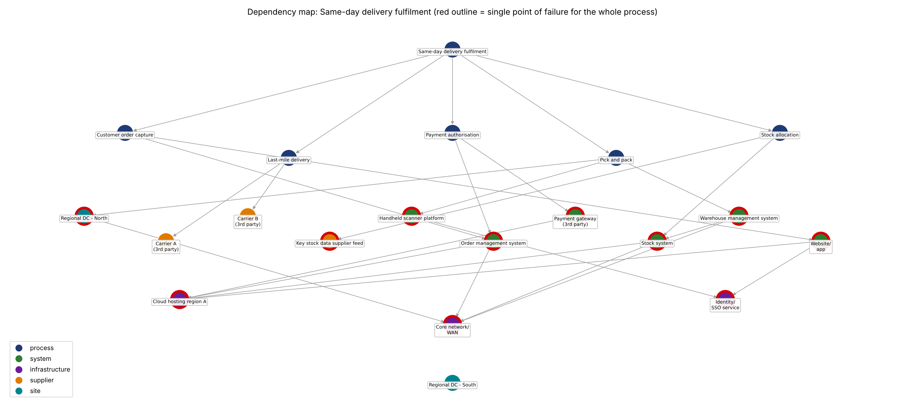
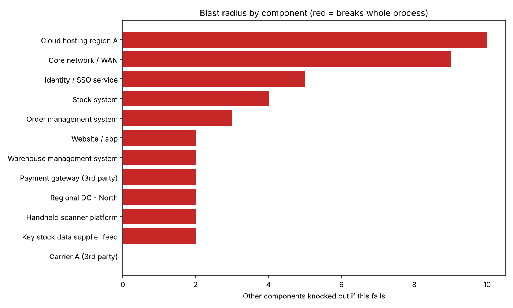

# Dependency network analysis

> Map a critical process as a graph to find single points of failure, third-party concentration and recovery-time conflicts (fictional process).





**Problem.** Same-day delivery looks like one process but depends on systems, infrastructure, suppliers and sites.
Where would one failure stop the whole process, and are recovery expectations consistent?

**Approach.** Modelled a fictional critical process as a directed graph of 20 components (systems, infrastructure, suppliers,
sites) with owners, internal/external flag and a recovery time objective (RTO) for each. Wrote a failure-propagation
function that handles redundancy (Carrier A or B). Then ran: single-point-of-failure scan, third-party concentration, a two-failure
stress test and an RTO consistency check.

**Results.**
- 11 supporting components are single points of failure for the whole process. Highest blast radius: Cloud hosting region A (knocks out 10 other components) and Core network/WAN (9), then Identity/SSO (5).
- Concentration risk: the payment gateway (a third party) also sits on Cloud hosting region A, so it is not independent of it.
- Redundancy works only partly: losing Carrier A or B alone is survivable, but losing both breaks last-mile delivery. That was the only compound failure found.
- Regional DC South exists in the inventory but is not wired into same-day fulfilment, so it is probably unused failover capacity.
- 4 RTO conflicts: for example the order management system has a 2-hour RTO but supports two steps that must recover in 1 hour; the North DC (8 hours) supports pick and pack (4 hours).

**What I would tell leadership.** Concentration on one cloud region and one network is the biggest exposure. Test the
recovery of those two first, align the conflicting RTOs, and decide whether DC South should be made a real fallback.

**Limitations.** The map is fictional and hand-built. Real use needs inputs from BIA workshops with process owners, and should add data
flows and likelihoods, not only impact.

Files: `dependency_network.py`, `dependency_map.png`, `blast_radius.png`, `spof_ranking.csv`, `third_party_concentration.csv`, `compound_failures.csv`, `rto_conflicts.csv`.

## Run it
```
pip install -r requirements.txt
python3 dependency_network.py
```
Fixed random seeds, so results reproduce exactly. All data is synthetic or assumption-based; no real company data is used.

Part of a series of data-driven risk and operational resilience projects by Suhas Suresha.
